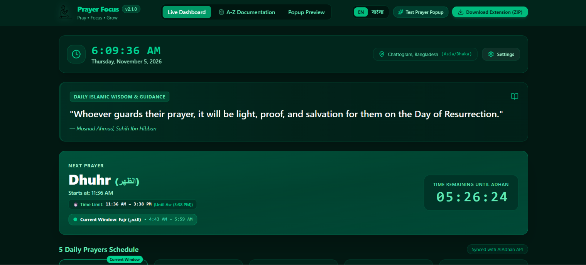
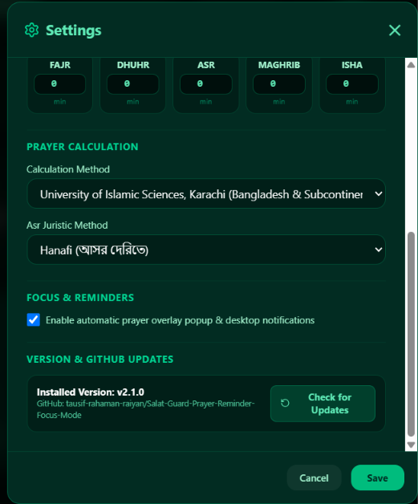

# 🕌 Prayer Focus – Pray • Focus • Grow (v2.2.0)

> **A production-ready Islamic productivity Chrome extension & companion web dashboard designed to protect your 5 daily prayers, maintain focus, and foster a consistent Quran habit without disrupting your original Chrome New Tab.**

[](https://github.com/tausif-rahaman-raiyan/Salat-Prayer-Reminder/actions/workflows/build-and-package.yml)
[](https://developer.chrome.com/docs/extensions/mv3/intro/)
[](https://github.com/tausif-rahaman-raiyan/Salat-Prayer-Reminder)
[](https://opensource.org/licenses/Apache-2.0)

---

## 📸 Screenshots & Visual Preview

### 1. Main Dashboard Overview & Current Prayer Window

*Features: Live Asia/Dhaka clock, Global City location badge, Daily Islamic guidance quote, Next Prayer banner with live countdown, and Current Prayer Window badge (`Current Window: Fajr`).*

### 2. Settings & Configuration Modal with GitHub Update Check

*Features: Permanent prayer adjustments (+/- minutes), calculation methods, focus reminder toggle, and Version & GitHub Updates check.*

---

## 🌐 Table of Contents
1. [English Overview](#english-overview)
   - [Core Philosophy](#core-philosophy)
   - [Key Features](#key-features)
   - [Absolute Requirement: Chrome New Tab Preservation](#absolute-requirement-chrome-new-tab-preservation)
   - [Zero Demo Data Standard](#zero-demo-data-standard)
   - [Automatic Prayer Popup & 2 Strict Buttons](#automatic-prayer-popup--2-strict-buttons)
   - [Extension Installation (Developer Mode)](#extension-installation-developer-mode)
   - [GitHub Push & Setup Instructions](#github-push--setup-instructions)
   - [GitHub Actions Workflow](#github-actions-workflow)
2. [বাংলা বিবরণ ও নির্দেশিকা (Bengali Guide)](#বাংলা-বিবরণ-ও-নির্দেশিকা-bengali-guide)
   - [মূল উদ্দেশ্য ও বৈশিষ্ট্য](#মূল-উদ্দেশ্য-ও-বৈশিষ্ট্য)
   - [ক্রোম নিউ ট্যাব অপরিবর্তিত রাখার নিশ্চয়তা](#ক্রোম-নিউ-ট্যাব-অপরিবর্তিত-রাখার-নিশ্চয়তা)
   - [গিটহাবে পুশ ও ব্যবহারের পূর্ণাঙ্গ নির্দেশিকা](#গিটহাবে-পুশ-ও-ব্যবহারের-পূর্ণাঙ্গ-নির্দেশিকা)
3. [Architecture & File Structure](#architecture--file-structure)
4. [Testing Suite](#testing-suite)
5. [Browser Limitations](#browser-limitations)

---

## English Overview

### Core Philosophy
In a hyper-distracted digital world, work, study, and social browsing often push prayer times to the very edge or cause them to be missed entirely. **Prayer Focus** solves this with an intentional, non-disruptive, privacy-first companion built specifically on Google Chrome Manifest V3.

### Key Features
- **Preserves Original Chrome New Tab**: Absolute preservation of `chrome://newtab`, Google search, default bookmarks, and shortcuts.
- **No Sidebar Full-Width Dashboard**: Expansive dark emerald glassmorphism layout with live Dhaka clock, Gregorian & Bengali dates, upcoming prayer countdown, and monthly activity tracker.
- **Strictly Zero Demo Data**: A newly installed extension starts completely clean. If no activity is recorded, it displays: `"আজকের কোনো কার্যক্রম এখনো রেকর্ড করা হয়নি।"` (No activity recorded for today).
- **Accurate Real-time Prayer Engine**: Automatic API synchronization with AlAdhan (with offline fallback caching) calibrated for Chattogram / Bangladesh (`Asia/Dhaka`, UTC+6 without daylight saving shifts).
- **Genuine 5-Prayer Tracker**: Honest user actions (`পড়েছি` / Prayed, `ছুটেছে` / Missed) to cultivate genuine self-accountability.
- **Self-Reported Quran Timer**: Start, pause, stop & save, and reset your reading sessions with persistence across page reloads.
- **Verified Islamic Quotes**: Over 62 authentic Bengali Quranic verses (Surah:Ayah) and authentic Hadith references.

---

### Absolute Requirement: Chrome New Tab Preservation
Unlike other extensions that hijack Chrome's homepage or search engine:
- **NO** `chrome_url_overrides` in `manifest.json`.
- **NO** URL redirects when opening a new browser tab.
- Access the dashboard whenever you choose via the toolbar popup icon or direct bookmark.

---

### Zero Demo Data Standard
- **No hardcoded stats** or fake completion percentages.
- **No fake historical charts** or mock streaks.
- All calculations are performed in real-time on pure user interaction saved in Chrome Storage (`chrome.storage.local`).

---

### Automatic Prayer Popup & 2 Strict Buttons
When an active prayer window starts:
1. An elegant, glassmorphic dark emerald overlay smoothly appears on supported open websites.
2. It displays the prayer name, prayer time, and a daily verified Quranic quote.
3. It presents **EXACTLY TWO ACTIONS** (no dismiss, no close, no cancel):
   - **Button 1: `✓ আমি নামাজে যাচ্ছি` (I am going to pray)**:
     - Initiates an 8-minute focus session.
     - Blocks distracting web pages with an emerald reflection screen so you step away for Salah.
     - Does **not** automatically mark prayer as completed (honesty first).
   - **Button 2: `৫ মিনিট পরে মনে করিয়ে দিন` (Remind me in 5 minutes)**:
     - Snoozes for exactly 5 minutes with zero duplicate reminders.

---

### Extension Installation (Developer Mode)

1. **Get the files**: Clone this repository or download `prayer-focus-v2.2.0.zip`.
2. **Open Extensions**: In Google Chrome, go to `chrome://extensions/`.
3. **Turn on Developer Mode**: Toggle the switch at top-right.
4. **Load Unpacked**:
   - Click **Load unpacked** (top-left).
   - Select the `prayer-focus-v2` directory from this repository.
5. **Pin to Toolbar**: Click the extensions puzzle icon in Chrome and pin **Prayer Focus**.

---

### GitHub Push & Setup Instructions

To push this entire project to your personal GitHub repository:

```bash
# 1. Initialize git (if not already initialized)
git init

# 2. Add all files to staging
git add .

# 3. Create your initial commit
git commit -m "feat: release Prayer Focus v2.2.0 Chrome Extension & full web documentation"

# 4. Set branch to main
git branch -M main

# 5. Link your GitHub remote repository (replace with your repo URL)
git remote add origin https://github.com/<YOUR_GITHUB_USERNAME>/<YOUR_REPOSITORY_NAME>.git

# 6. Push to GitHub
git push -u origin main
```

---

### GitHub Actions Workflow
The included file `.github/workflows/build-and-package.yml` automatically triggers on every push to `main`:
1. Installs project dependencies.
2. Runs the TypeScript linter and automated test suite.
3. Builds the production web app (`dist/`).
4. Automatically increments release version tag (`v2.1.X`) and packages `prayer-focus.zip`.
5. Uploads both as downloadable GitHub artifacts.

---

## বাংলা বিবরণ ও নির্দেশিকা (Bengali Guide)

### মূল উদ্দেশ্য ও বৈশিষ্ট্য
- **Prayer Focus (সালাত ও কোরআন ফোকাস)** হলো গুগল ক্রোমের একটি পূর্ণাঙ্গ প্রোডাকশন-রেডি এক্সটেনশন (Manifest V3) ও ওয়েব প্ল্যাটফর্ম।
- এটি ওয়াক্ত শুরু হলে ওয়েবসাইটে স্বয়ংক্রিয়ভাবে পূর্ণস্ক্রিন নামাজ রিমাইন্ডার দেয় এবং নামাজ আদায়কালীন সময়ে সাইট সাময়িক ব্লক রেখে মনোযোগ ধরে রাখতে সহায়তা করে।
- এতে কোনো মিথ্যা বা ডেমো ডেটা রাখা হয়নি; আপনি নিজে যখন 'পড়েছি' বা 'ছুটেছে' চিহ্নিত করবেন, কেবল তখনই হিসেব তৈরি হবে।

### ক্রোম নিউ ট্যাব অপরিবর্তিত রাখার নিশ্চয়তা
- আপনার ক্রোমের মূল নিউ ট্যাব (New Tab), গুগল সার্চ বার, বুকমার্ক ও শর্টকাট সম্পূর্ণ অক্ষত থাকবে।
- এক্সটেনশনটি টুলবার আইকন বা আলাদা ড্যাশবোর্ড হিসেবে ওপেন হয়।

### গিটহাবে পুশ ও ব্যবহারের পূর্ণাঙ্গ নির্দেশিকা
১. টার্মিনালে প্রজেক্টের রুট ডিরেক্টরিতে যান।  
২. `git add .` দিয়ে সব ফাইল স্টেজ করুন।  
৩. `git commit -m "Initial commit of Prayer Focus v2.0"` দিয়ে কমিট করুন।  
৪. আপনার গিটহাব অ্যাকাউন্টে একটি নতুন রিপোজিটরি তৈরি করে `git remote add origin <URL>` দিয়ে কানেক্ট করুন।  
৫. `git push -u origin main` কমান্ড রান করলেই আপনার গিটহাবে পুশ হয়ে যাবে এবং গিটহাব অ্যাকশনস নিজে থেকেই সম্পূর্ণ জিপ ও ওয়েবসাইট বিল্ড করে দিবে!

---

## Architecture & File Structure

```text
├── .github/
│   └── workflows/
│       └── build-and-package.yml   # Automated GitHub CI/CD build & packaging
├── prayer-focus-v2/               # Standalone Unpacked Chrome Extension
│   ├── manifest.json              # Manifest V3 configuration
│   ├── background/
│   │   ├── service-worker.js      # Background event bus
│   │   ├── scheduler.js           # chrome.alarms schedule listener
│   │   ├── notification-manager.js# Native desktop alerts
│   │   └── session-manager.js     # State machine (notified, snoozed, focus_active)
│   ├── content/
│   │   ├── content.js             # Overlay injector on websites
│   │   └── overlay.css            # Dark emerald glassmorphism stylesheet
│   ├── popup/
│   │   ├── popup.html             # Toolbar action popup
│   │   ├── popup.js               # Popup countdown and controls
│   │   └── popup.css              # Popup styling
│   ├── dashboard/
│   │   ├── dashboard.html         # Full-width standalone dashboard (no sidebar)
│   │   ├── dashboard.js           # Clock, prayer logging, quran timer & settings
│   │   └── dashboard.css          # Full-width dashboard styles
│   ├── modules/
│   │   ├── storage.js             # Chrome storage wrapper
│   │   ├── prayer-api.js          # AlAdhan API fetcher & next prayer math
│   │   ├── timezone.js            # Asia/Dhaka time handler (UTC+6)
│   │   ├── quotes.js              # 62 authentic Bengali Quran/Hadith reminders
│   │   ├── calendar.js            # Monthly interactive prayer log
│   │   ├── quran-timer.js         # Quran reading habit tracker
│   │   └── prayer-tracker.js      # Actual 5-prayer completion statistics
│   ├── assets/icons/              # PNG icons (16px, 32px, 48px, 128px)
│   └── tests/
│       └── prayer-engine.test.js  # Automated unit test suite
├── src/                           # React 19 + Tailwind Web Application
│   ├── App.tsx                    # Full Web App with A-Z Documentation & Simulator
│   ├── main.tsx
│   └── index.css
├── public/
│   └── prayer-focus.zip           # Ready-to-download packaged extension
└── README.md                      # Comprehensive A-Z Documentation
```

---

## Testing Suite
Run the test suite anytime with:
```bash
node prayer-focus-v2/tests/prayer-engine.test.js
```
Tested cases:
- [x] Accurate `Asia/Dhaka` local date generation (`YYYY-MM-DD`).
- [x] Bengali numeral parsing and formatting.
- [x] Fixed UTC+6 prayer epoch calculations without DST drift.
- [x] Next prayer window detection and countdown logic.
- [x] Manifest V3 absence of `chrome_url_overrides` (Chrome New Tab preservation).

---

## Browser Limitations
- **Chrome Internal Pages**: Due to Chrome browser security policies, extensions cannot run content scripts on internal URLs such as `chrome://*`, `chrome-extension://*`, and the Chrome Web Store. The extension UI makes this sandbox boundary transparent to the user.
