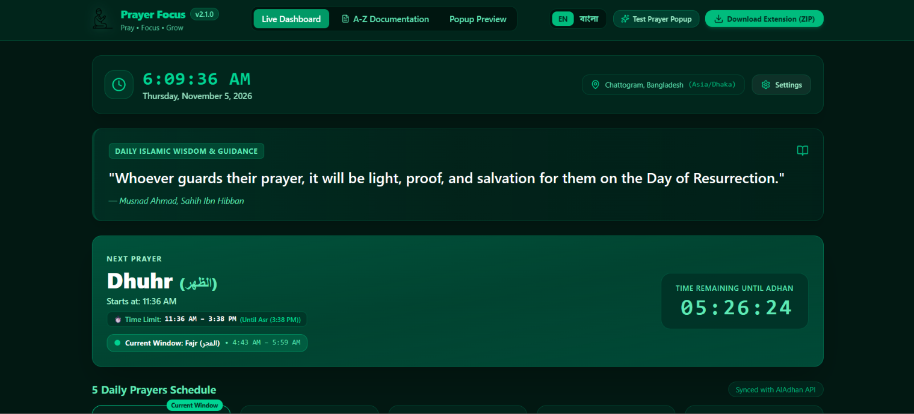
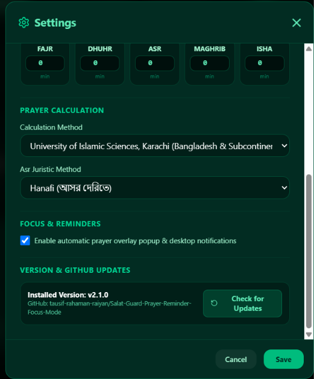

# Prayer Focus – Pray • Focus • Grow
**Version: 2.1.0**  
Platform: Google Chrome (Manifest V3)  
Default Location: Chattogram, Bangladesh  
Timezone: `Asia/Dhaka` (UTC+6, strictly handled without DST assumptions)

---

## 📸 Screenshots & Visual Preview

### 1. Main Dashboard & Current Prayer Window


### 2. Settings Modal with Version & GitHub Update Check


---

## 🌟 Key Architectural Features

1. **Strictly Preserves Chrome New Tab**:
   - `chrome://newtab` is never modified or overridden.
   - Your original bookmarks, Google Search, and default Chrome New Tab experience remain 100% untouched.
   - The dashboard opens independently from the toolbar popup action button or direct URL.

2. **Clean Full-Width Dashboard (No Sidebar)**:
   - Sidebar completely eliminated in favor of an expansive dark emerald glassmorphism layout.
   - Live Dhaka clock and Bengali calendar date.
   - Next prayer banner with live 1-second countdown.
   - 5 daily prayer cards with actual honest recording actions (`পড়েছি` / `ছুটেছে`).
   - Quran reading timer with start/pause/save/reset and persistent state.
   - Interactive monthly calendar with prayer history dots and date detail views.

3. **Zero Demo Data Policy**:
   - No hardcoded fake statistics or fabricated historical logs.
   - Fresh installation displays: `"আজকের কোনো কার্যক্রম এখনো রেকর্ড করা হয়নি।"`.
   - Real-time JavaScript calculations based strictly on user storage entries.

4. **Automatic Namaz-Time Popup & Website Focus Lock**:
   - When a prayer starts, an elegant full-screen overlay appears on supported websites.
   - **Exactly Two Buttons**:
     - **Button 1**: `✓ আমি নামাজে যাচ্ছি` (Activates an 8-minute focus session with full website block overlay).
     - **Button 2**: `৫ মিনিট পরে মনে করিয়ে দিন` (Snoozes reminders for exactly 5 minutes without duplicate alerts).
   - Rotating library of 62+ verified authentic Bengali Quran verses and Hadith citations.

5. **Manifest V3 Background Service Worker**:
   - Uses `chrome.alarms` for alarm scheduling (no unstable `setInterval` background loops).
   - Idempotent session state machine (`scheduled`, `notified`, `snoozed`, `focus_active`).
   - Robust recovery across Chrome restarts and suspension.

---

## 🚀 How to Install in Google Chrome (Developer Mode)

1. **Download / Extract**:
   - Download the file `prayer-focus-v2.1.0.zip` or use the `prayer-focus-v2` directory.
   - Unzip if using the zip archive so you have the `prayer-focus-v2` folder containing `manifest.json`.
2. **Open Chrome Extension Manager**:
   - In Google Chrome address bar, navigate to: `chrome://extensions/`
3. **Enable Developer Mode**:
   - Toggle the switch labeled **Developer mode** in the top-right corner.
4. **Load Unpacked**:
   - Click the **Load unpacked** button in the top-left.
   - Select the `prayer-focus-v2` directory.
5. **Pin and Use**:
   - Click the puzzle icon in Chrome's toolbar and pin **Prayer Focus**.
   - Click the icon to view current and next prayer timings, or click **ড্যাশবোর্ড খুলুন** to open the full dashboard.

---

## 📁 File Structure

```text
prayer-focus-v2/
├── manifest.json
├── background/
│   ├── service-worker.js
│   ├── scheduler.js
│   ├── notification-manager.js
│   └── session-manager.js
├── content/
│   ├── content.js
│   └── overlay.css
├── popup/
│   ├── popup.html
│   ├── popup.js
│   └── popup.css
├── dashboard/
│   ├── dashboard.html
│   ├── dashboard.js
│   └── dashboard.css
├── modules/
│   ├── storage.js
│   ├── prayer-api.js
│   ├── timezone.js
│   ├── quotes.js
│   ├── calendar.js
│   ├── quran-timer.js
│   └── prayer-tracker.js
├── assets/
│   └── icons/
│       ├── icon16.png
│       ├── icon32.png
│       ├── icon48.png
│       └── icon128.png
├── tests/
│   └── prayer-engine.test.js
└── README.md
```

---

## 🔒 Known Browser Limitations
- **Chrome Internal Pages**: Google Chrome security policy strictly prevents extensions from injecting content scripts or blocking `chrome://`, `chrome-extension://`, and the Chrome Web Store. The extension UI clearly informs the user of this browser sandbox standard.
